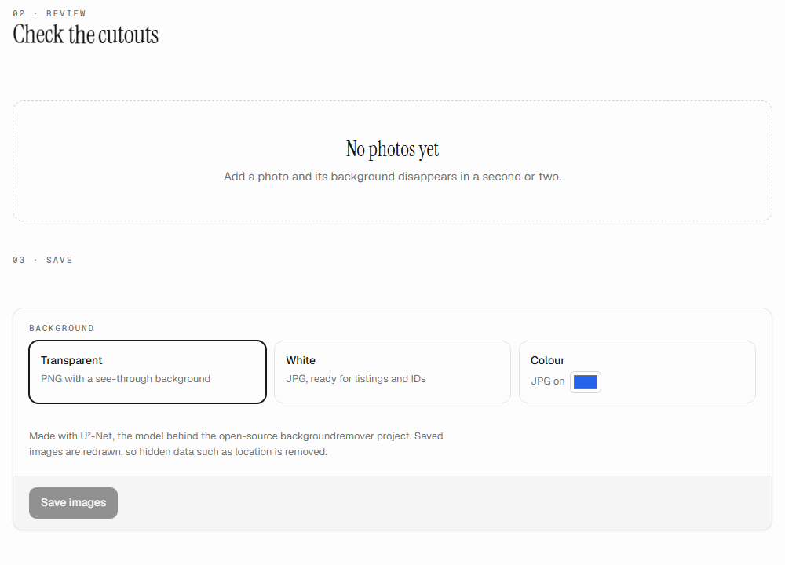
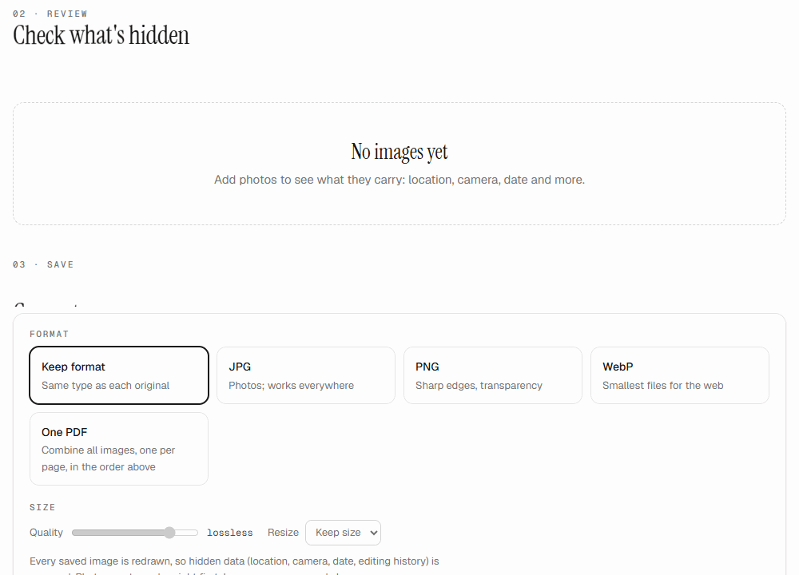
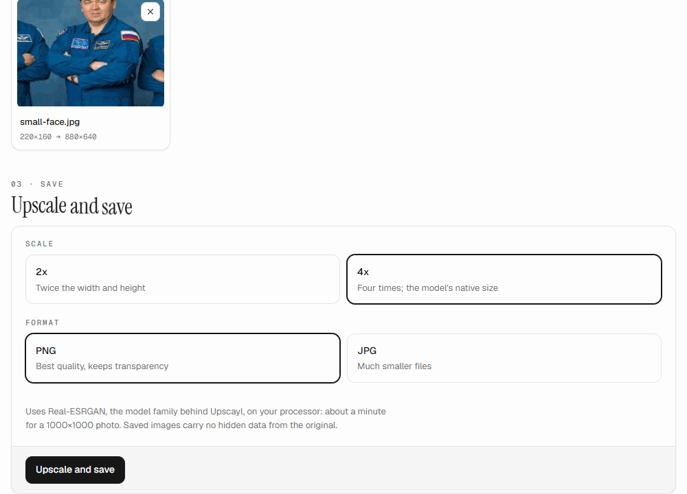
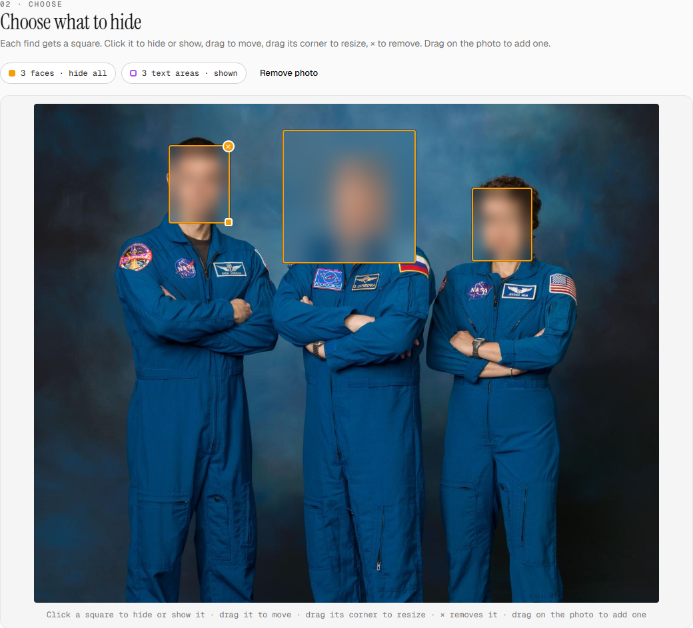
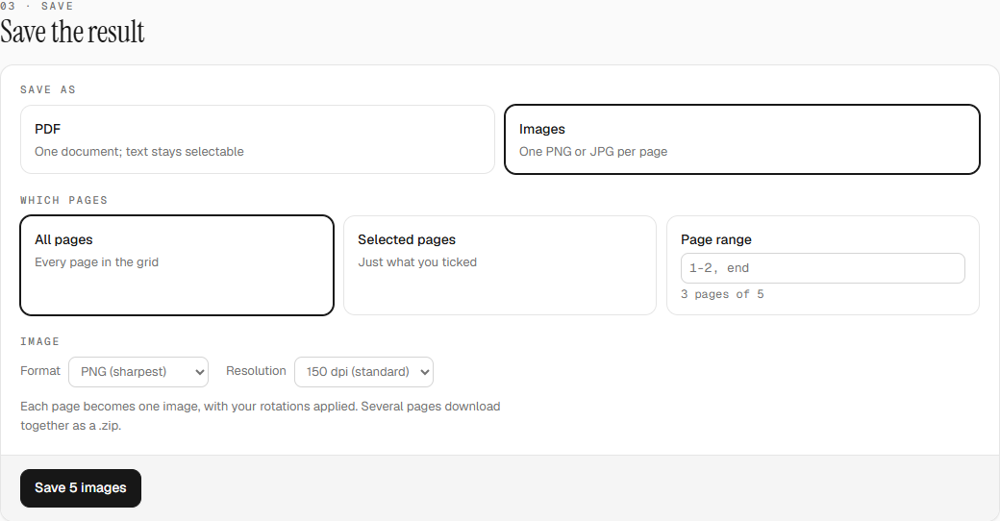

<div align="center">

# Pocket Tools

**Private tools for your PDFs and photos that run entirely in your browser.**<br>
Merge PDFs, convert images, blur faces, remove backgrounds and upscale photos, without uploading anything.

by **[Yiguang Ma](https://github.com/YiguangM)**


<picture>
  <source media="(prefers-color-scheme: dark)" srcset="docs/media/home-dark.png">
  
</picture>

[The tools](#the-tools) · [Guides](#guides) · [Install](#install) · [Privacy](#how-private-is-it-really) · [Questions](#questions)

</div>

## Why

Most "free online" PDF and photo tools upload your files to someone else's server: contracts, IDs, family photos. Pocket Tools does the same jobs **inside your browser tab**. Your files are read into memory on your own computer, processed there, and saved back to your downloads. They are never sent anywhere, and after the first visit the app works with no internet connection at all.

## The tools

| Tool | What it does |
|---|---|
| 📄 [PDF toolbox](#-pdf-toolbox) | Merge, reorder, rotate, split and shrink PDFs, or save pages as images |
| 🙈 [Face and plate blur](#-face-and-plate-blur) | Find faces, license plates and text, then blur or pixelate them |
| ✂️ [Background remover](#️-background-remover) | Cut people, pets and products out of photos |
| 🖼️ [Image converter](#️-image-converter) | JPG ⇄ PNG ⇄ WebP ⇄ PDF, resize, and strip hidden location data |
| 🔍 [Image upscaler](#-image-upscaler) | Make small or blurry images 2× or 4× bigger with AI |

### 📄 PDF toolbox

Merge several PDFs, then reorder, rotate or delete pages. Save everything, just the selected pages, a page range, or split it into parts. Optionally shrink the file, or save pages as images.

<p align="center"></p>

### 🙈 Face and plate blur

Finds **faces, license plates and text** in a photo and puts a square on each one. You decide what gets blurred before you share the photo. Works on crowds and on tilted or upside-down heads.

<p align="center"></p>

### ✂️ Background remover

Cuts people, pets and products out of photos and saves them with a transparent, white or coloured background.

<p align="center"></p>

### 🖼️ Image converter

Converts between **JPG, PNG and WebP**, shrinks and resizes images, or **combines them into one PDF**. Before you save, it shows what each photo is secretly carrying, such as GPS location and camera model, and the saved copies come out clean.

<p align="center"></p>

### 🔍 Image upscaler

Makes small or blurry images **2× or 4× bigger**, with detail filled in by AI.

<p align="center"></p>

## Guides

<details open>
<summary><b>Blur faces and plates before posting a photo</b></summary>

1. Open **Face and plate blur** and drop your photos anywhere on the page.
2. Wait a few seconds. Every face (amber) and license plate (blue) gets a square and is blurred straight away. Text (purple) is marked but left visible.
3. Check the preview, then fix anything that needs it:
   - **Click** a square to show or hide that one.
   - **Drag** a square to move it; drag its **corner** to resize it.
   - **×** removes a square; **drag on the photo** to cover something the AI missed.
   - The buttons above the photo switch all faces, plates or text at once.
4. Under **Save**, pick **Blur**, **Pixelate** or **Black box**, set the strength, and press **Save**. Several photos come as a ZIP.

Keyboard: arrow keys move the selected square, Shift + arrows resize it, Delete removes it.

<p align="center"></p>
</details>

<details>
<summary><b>Merge PDFs and remove pages</b></summary>

1. Open **PDF toolbox** and drop all your PDFs at once. Their pages appear in one grid, in order.
2. Remove unwanted pages with the **×** under each page, or tick several and press **Delete**.
3. Put pages in order: drag them, or use the **‹ ›** arrows under each page. **Reverse** flips the whole order.
4. Turn sideways pages with the **rotate** button.
5. Under **Save**, keep **PDF** and **All pages**, then press **Save PDF**. Pressed something by mistake? **Undo**, or **Ctrl + Z**, goes back.

Tip: tick **Compress** to make a big scanned PDF much smaller (the pages become pictures, so text is no longer selectable).
</details>

<details>
<summary><b>Turn PDF pages into images</b></summary>

1. Open **PDF toolbox** and drop the PDF.
2. Under **Save**, choose **Images**.
3. Pick the pages: all, the ones you ticked, or a range like `1-3, 7, 10-end`.
4. Choose **PNG** or **JPG** and the resolution (150 dpi is good for screens, 300 dpi for printing), then **Save**. One page downloads as an image; several come as a ZIP.

<p align="center"></p>
</details>

<details>
<summary><b>Make a product photo with a white background</b></summary>

1. Open **Background remover** and drop one or more photos.
2. Each photo is cut out on its own within a second or two. Click one to compare **before** and **after**.
3. Under **Background**, choose **Transparent** (PNG), **White** (JPG) or **Colour** to pick your own, then **Save**.

Works best on one clear subject: a person, a pet, a product.
</details>

<details>
<summary><b>Remove hidden location data from photos</b></summary>

Phones save where a photo was taken inside the file. Anyone you send it to can read it.

1. Open **Image converter** and drop your photos. Any photo carrying a location gets a red **Location** tag.
2. Click a photo to see exactly what's inside: GPS coordinates, camera, date.
3. Keep **Keep format** selected, or pick a format, and press **Save**. The saved copies contain only the picture; the hidden data is gone.

<p align="center"></p>
</details>

<details>
<summary><b>Combine photos into one PDF</b></summary>

1. Open **Image converter** and drop the photos (receipts, scans, pages).
2. Put them in order with the **‹ ›** arrows under each card; the number in the corner is the page number.
3. Under **Format**, choose **One PDF**, pick **A4**, **US Letter** or **Fit each image**, and press **Save PDF**.
</details>

<details>
<summary><b>Enlarge a small or blurry picture</b></summary>

1. Open **Image upscaler** and drop the image.
2. Choose **2x** or **4x**, and **PNG** (best quality) or **JPG** (smaller file).
3. Press **Upscale and save**. A progress line counts the pieces; a 1000 × 1000 photo takes about a minute.
4. Click the result to compare it with a plain enlargement.
</details>

## Install

You need **[Node.js](https://nodejs.org) 22.22 or newer** (the LTS version is fine).

```sh
git clone https://github.com/YiguangM/Pocket-Tools.git
cd Pocket-Tools
npm install
```

Then pick one:

| I want to… | Run | Then |
|---|---|---|
| **Use it as an app on Windows** | `npm run shortcut` | Open **Pocket Tools** from your Desktop, the Start menu, or the shortcut in the project folder. It opens in its own window and stops when you close it. |
| **Use it in my browser** | `npm run build` and then `npm run preview` | Open the address it prints (usually http://localhost:4173). |
| **Work on the code** | `npm run dev` | See the [developer guide](docs/DEVELOPMENT.md). |

The first time you use an AI tool, its model (5 to 20 MB) is loaded from your own copy of the app and kept for next time. After an update, the next time you open the app you get the new version.

## How private is it, really?

- **Nothing leaves your computer.** There is no server-side processing at all: the app is plain files your browser runs.
- **Enforced, not just promised.** A strict Content-Security-Policy stops the page from talking to any other website, and an automated test fails if any code ever tries to make a network request.
- **AI included.** The face, plate, text, background and upscaling models are bundled with the app and run on your own device.
- **Works offline.** After the first visit you can disconnect from the internet and keep using every tool.

## Questions

**Which browsers work?**
It's developed and tested in Google Chrome. Other up-to-date browsers, like Edge and Firefox, should work too.

**Is the AI as good as the online services?**
For everyday photos, yes. The face finder handles crowds and tilted heads, but no detector catches everything, so always glance at the result before sharing. The upscaler runs on your processor rather than a graphics card, so expect around a minute for a large photo.

**Can I add my own tool?**
Yes. Each tool is a folder in `src/tools/`. See the [developer guide](docs/DEVELOPMENT.md).

## Credits

Built with React, Vite, [pdf.js](https://github.com/mozilla/pdf.js), [pdf-lib](https://github.com/Hopding/pdf-lib) and [ONNX Runtime Web](https://github.com/microsoft/onnxruntime). AI models from [backgroundremover](https://github.com/nadermx/backgroundremover) / U²-Net, [Real-ESRGAN](https://github.com/xinntao/Real-ESRGAN), [OpenCV YuNet](https://github.com/opencv/opencv_zoo), [open-image-models](https://github.com/ankandrew/open-image-models) and [PaddleOCR](https://github.com/PaddlePaddle/PaddleOCR); their licenses are in [`public/licenses/`](public/licenses/).

Demo photos: NASA (public domain).

---

<div align="center">

Made by **[Yiguang Ma](https://github.com/YiguangM)**

</div>
