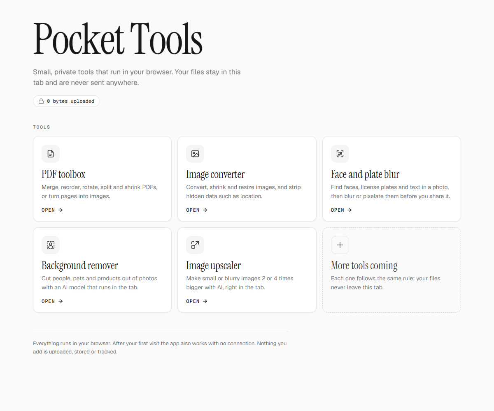
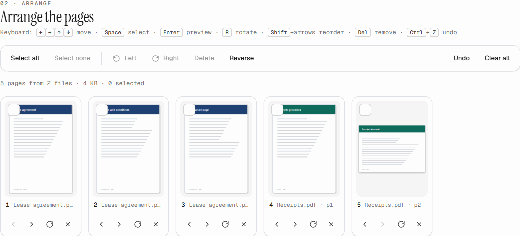
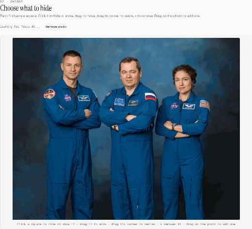
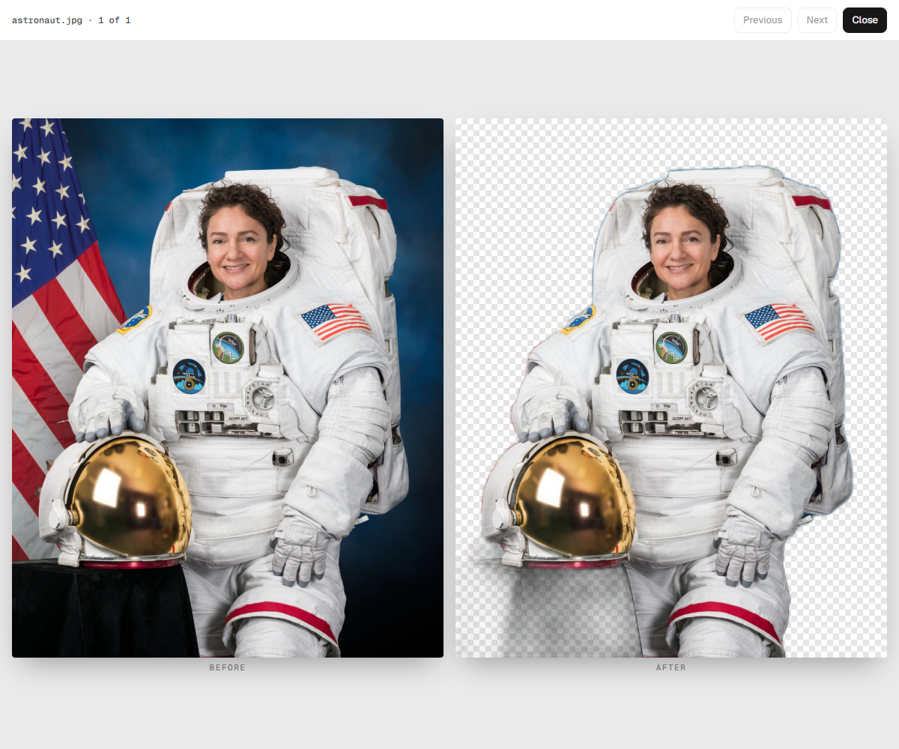
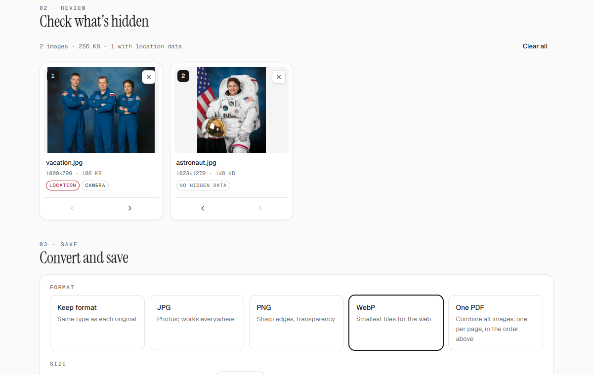
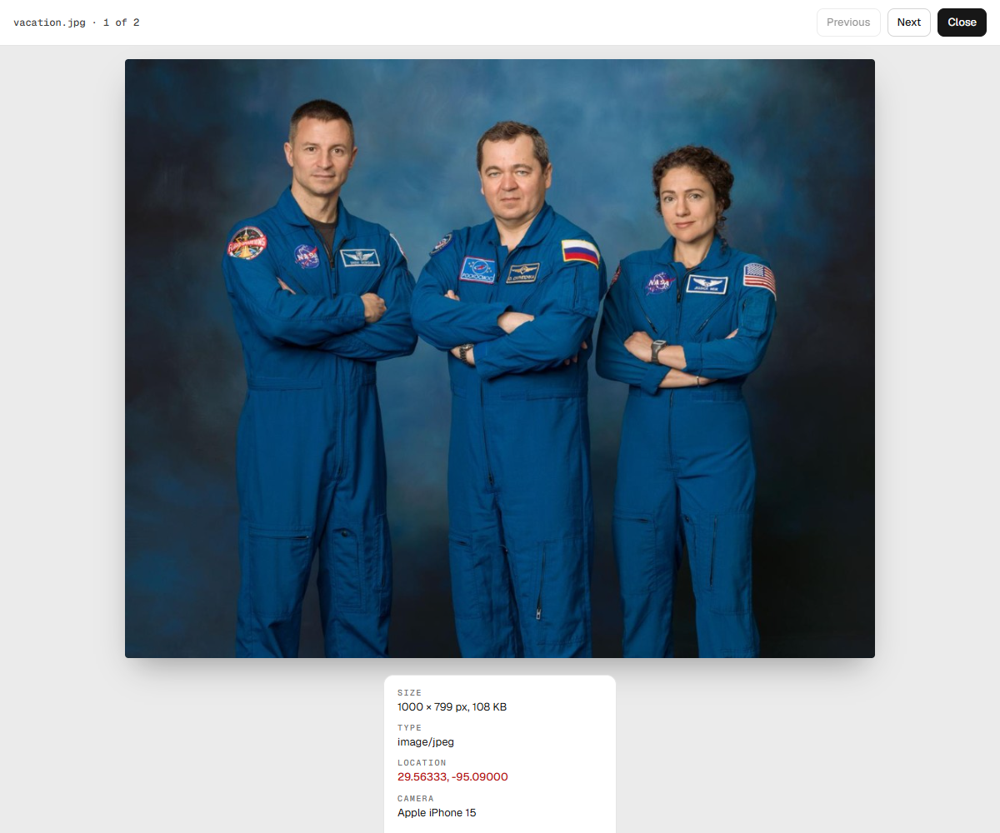
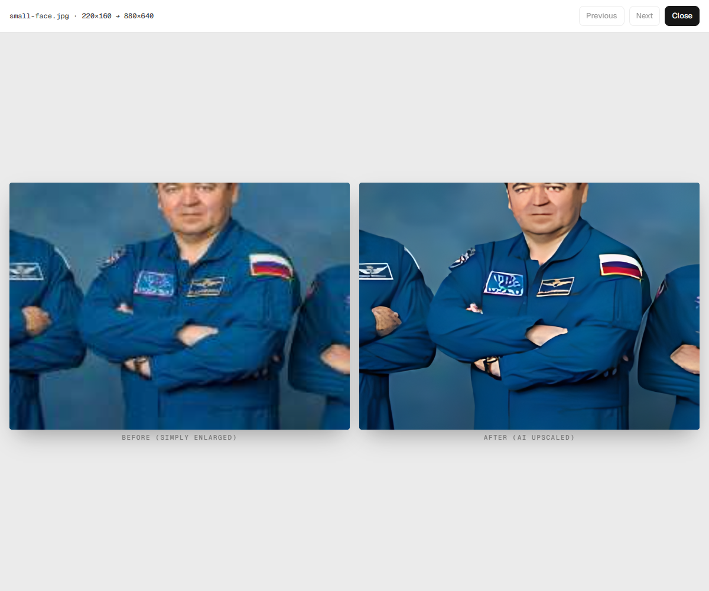

<div align="center">

# Pocket Tools

**Private tools for your PDFs and photos that run entirely in your browser.**<br>
Merge PDFs, convert images, blur faces, remove backgrounds and upscale photos, without uploading anything.


<picture>
  <source media="(prefers-color-scheme: dark)" srcset="docs/media/home-dark.png">
  
</picture>

</div>

## Why

Most "free online" PDF and photo tools upload your files to someone else's server: contracts, IDs, family photos. Pocket Tools does the same jobs **inside your browser tab**. Your files are read into memory on your own computer, processed there, and saved back to your downloads. They are never sent anywhere, and after the first visit the app works with no internet connection at all.

## The tools

### 📄 PDF toolbox

Merge several PDFs, then reorder, rotate or delete pages. Save everything, just the selected pages, a page range, or split it into parts. Optionally shrink the file, or save pages as images.

<p align="center"></p>

1. Drop your PDFs anywhere on the page.
2. Click pages to select them; use the arrows, the rotate button, or drag pages to rearrange.
3. Choose **PDF** or **Images**, pick which pages, and press **Save**.

### 🙈 Face and plate blur

Finds **faces, license plates and text** in a photo and puts a square on each one. You decide what gets blurred before you share the photo.

<p align="center"></p>

1. Drop one or more photos. Faces and plates are hidden automatically; text is marked but left visible.
2. **Click** a square to hide or show it, **drag** to move it, drag its **corner** to resize, **×** to remove it. Drag on the photo to cover anything else.
3. Pick **Blur**, **Pixelate** or **Black box**, then save.

Blur and pixelate throw the detail away, so the original can't be recovered from the saved copy. Location and camera data are removed as well.

### ✂️ Background remover

Cuts people, pets and products out of photos and saves them with a transparent, white or coloured background.

<p align="center"></p>

### 🖼️ Image converter

Converts between **JPG, PNG and WebP**, shrinks and resizes images, or **combines them into one PDF**. Before you save, it shows what each photo is secretly carrying, such as GPS location and camera model, and the saved copies come out clean.

<p align="center"></p>

<p align="center"></p>

### 🔍 Image upscaler

Makes small or blurry images **2× or 4× bigger**, with detail filled in by AI.

<p align="center"></p>

## Getting started

You need **[Node.js](https://nodejs.org) 22.22 or newer** (the LTS version is fine).

```sh
git clone https://github.com/YiguangM/Pocket-Tools.git
cd Pocket-Tools
npm install
```

Then pick one:

| I want to… | Run | Then |
|---|---|---|
| **Use it as an app on Windows** | `npm run shortcut` | Open **Pocket Tools** from your Desktop or Start menu. It opens in its own window and stops when you close it. |
| **Use it in my browser** | `npm run build` and then `npm run preview` | Open the address it prints (usually http://localhost:4173). |
| **Work on the code** | `npm run dev` | See the [developer guide](docs/DEVELOPMENT.md). |

The first time you use an AI tool, its model (5 to 20 MB) is loaded from your own copy of the app and kept for next time.

## How private is it, really?

- **Nothing leaves your computer.** There is no server-side processing at all: the app is plain files your browser runs.
- **Enforced, not just promised.** A strict Content-Security-Policy stops the page from talking to any other website, and an automated test fails if any code ever tries to make a network request.
- **AI included.** The face, plate, text, background and upscaling models are bundled with the app and run on your own device.
- **Works offline.** After the first visit you can disconnect from the internet and keep using every tool.

## Questions

**Which browsers work?**
It's developed and tested in Google Chrome. Other up-to-date browsers, like Edge and Firefox, should work too.

**Is the AI as good as the online services?**
For everyday photos, yes. The face finder handles crowds and tilted heads, but no detector catches everything, so always glance at the result before sharing. The upscaler runs on your processor rather than a graphics card, so expect around a minute for a large photo.

**Can I add my own tool?**
Yes. Each tool is a folder in `src/tools/`. See the [developer guide](docs/DEVELOPMENT.md).

## Credits

Built with React, Vite, [pdf.js](https://github.com/mozilla/pdf.js), [pdf-lib](https://github.com/Hopding/pdf-lib) and [ONNX Runtime Web](https://github.com/microsoft/onnxruntime). AI models from [backgroundremover](https://github.com/nadermx/backgroundremover) / U²-Net, [Real-ESRGAN](https://github.com/xinntao/Real-ESRGAN), [OpenCV YuNet](https://github.com/opencv/opencv_zoo), [open-image-models](https://github.com/ankandrew/open-image-models) and [PaddleOCR](https://github.com/PaddlePaddle/PaddleOCR); their licenses are in [`public/licenses/`](public/licenses/).

Demo photos: NASA (public domain).
